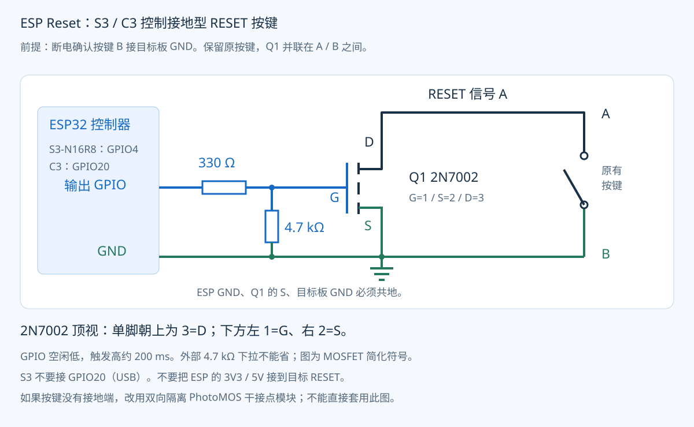

# 接线

每块板支持三路独立复位。各路空闲低、触发高，约 200 ms 后松开，独立冷却 3 秒。使用板上 GPIO 丝印，不是排针序号。

| 通道 | S3-N16R8 | C3 SuperMini |
| --- | --- | --- |
| 1 | GPIO4 | GPIO3 |
| 2 | GPIO5 | GPIO4 |
| 3 | GPIO6 | GPIO5 |

**C3 不使用 GPIO20/21。旧单路 GPIO20 接线不再适用。** 每路需要独立的开关元件、330 Ω 和 4.7 kΩ 电阻，共三套。

## RESET 一端接 GND 的接法

断电测量原按键两触点：一个与目标板 GND 导通，称 B；另一个是 RESET 信号，称 A。按下时 A/B 导通。四脚按键通常有两组内部常通脚，要选“松开不通、按下才通”的两组之间接线。

| 器件接点 | 接到哪里 |
| --- | --- |
| 上表所选通道的 GPIO | 经 330 Ω 电阻接 2N7002 的 G |
| 2N7002 G 与 S | 跨接 4.7 kΩ 下拉 |
| 2N7002 S | C3/S3 GND，同时连接目标按键 B |
| 2N7002 D | 目标按键 A |

保留原按键。MOSFET 和原按键并联；不要把 ESP 的 3V3/5V 接到 RESET 信号。每路下拉不可省，用于上电、刷机、控制器重启时保持对应开关断开。不要把三路 GPIO 或三个 RESET 信号互相短接。MOSFET 接法需要控制器与目标板共地；不同目标板不适合共地时，使用三路独立隔离 PhotoMOS。

Nexperia 2N7002 / SOT-23：从顶部看，单脚朝上，上方是 **3=D**，下方左 **1=G**、右 **2=S**。不同器件或转接板以它自己的数据手册/丝印为准；2N7000 的直插封装脚序不能照抄 2N7002。

2N7002 用于小电流复位上拉信号。最终仍需按目标板电压、上拉电阻和复位低电平阈值核对。开关单独测试时先观察 GPIO 脉冲，再连接开发板。

## 用隔离 PhotoMOS 模块

如果不确定按键两端是否接地，或想做通用的两线按键模拟器，可换成**双向输出、3.3 V 高电平触发**的 PhotoMOS 干接点模块：

- 每路模块的输入 IN 分别接上表对应 GPIO，控制侧 GND 接 ESP GND；三路输出各接自己的目标按键。
- 输入按模块规格供电，并确保外部下拉让模块在 ESP 未上电/刷机时断开。
- 输出两个干接点并联目标按键两端，不与控制侧强制共地，不分输出方向。
- 裸 PhotoMOS 的输入是 LED，必须按所选器件触发电流计算限流电阻；不要把裸器件当成带驱动模块。
- 不要用低电平触发模块配这版默认固件。确认额定电压、电流、导通电阻和漏电满足目标电路。

## S3-N16R8 注意

- N16R8 表示 16 MB Flash / 8 MB PSRAM，不代表所有公版板排针和外围一致。
- 本项目不需要 PSRAM，不初始化它，保留模组内存引脚。
- GPIO19/20 是原生 USB，GPIO35/36/37 等可能接 Octal PSRAM，不能沿用旧 C3 的 GPIO20 接法。
- BOOT 用作长按恢复 Wi-Fi，ESP 板上的 RESET/EN 仍用于控制器自身重启。
- 建议 ESP 独立 USB 供电，避免目标板重置影响控制器供电。

参考：[ESP32-S3-DevKitC-1 引脚说明](https://docs.espressif.com/projects/esp-dev-kits/en/latest/esp32s3/esp32-s3-devkitc-1/user_guide_v1.1.html)、[2N7002 数据手册](https://assets.nexperia.com/documents/data-sheet/2N7002.pdf)。
